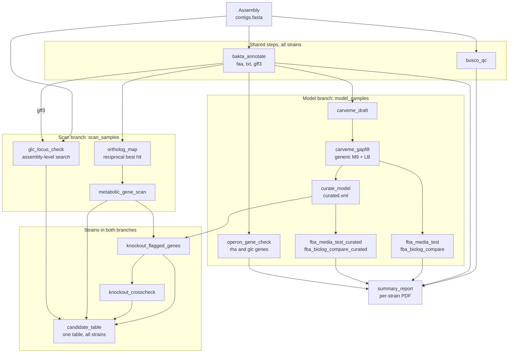

# Project GEM

Genome-scale metabolic modeling of Shiga toxin-producing *Escherichia coli* (STEC)
strains. The pipeline has two branches that share an assembly and an annotation:

- a **model branch** that reconstructs a metabolic model for each strain (CarveMe),
  runs flux balance analysis (COBRApy) and checks the predicted growth against measured
  Biolog phenotypes;
- a **scan branch** that scans a genome's annotated proteins against the *E. coli* K-12
  iML1515 metabolic gene set for missing or disrupted metabolic genes, works out which
  reactions those genes affect, and tests the effect in the strain models. It needs only
  an assembly and its annotation, so it can be used on strains without phenotype data.

This is a **pilot pipeline**. It writes a per-strain PDF summary and a cross-strain table of
candidate genes.

- Source data: BioProject [PRJNA559322](https://www.ncbi.nlm.nih.gov/bioproject/PRJNA559322)
- Phenotype data and strain classification: Barth et al. 2020, *Toxins* 12(6):414
  ([doi:10.3390/toxins12060414](https://doi.org/10.3390/toxins12060414))
- Orchestration: Snakemake on Slurm, one small conda environment per rule

## Pipeline



- **Shared steps** run for every strain in the accession file: assembly QC and annotation.
- **Model branch**: Bakta proteins -> CarveMe draft -> gap-fill on generic media ->
  curation (glyoxylate transport) -> FBA on single carbon sources, compared with Biolog
  before and after curation. The `summary_report` PDF is built from these results.
- **Scan branch**: Bakta proteins and the iML1515 reference -> reciprocal-best-hit ortholog
  map -> intact / disrupted / absent call for each of 1513 iML1515 metabolic genes.
  `glc_locus_check` searches the assembly directly for the rha/glc operon genes.
- **Join**: for strains in both branches, the flagged genes are knocked out of the curated
  model (via the iML1515 gene-protein-reaction rules), checked a second way with the
  strain's own locus tags, and merged with the scan results into `candidate_table.tsv`.

| Stage | Snakemake rule | Tool | Main output |
|---|---|---|---|
| Reads to FASTQ | `sra_to_fastq` | SRA Toolkit, pigz | `fastq/{sample}_{1,2}.fastq.gz` |
| Trimming | `fastp_trim` | fastp | `trimmed/{sample}_{1,2}.trim.fastq.gz` |
| Assembly | `spades_assembly` | SPAdes (`--isolate`) | `assembly/{sample}/contigs.fasta` |
| Assembly QC | `busco_qc` | BUSCO (`enterobacterales_odb10`) | `assembly/{sample}/busco/` |
| Annotation | `bakta_annotate` | Bakta | `annotation/{sample}/bakta/{sample}.{faa,txt,gff3}` |
| Draft model | `carveme_draft` | CarveMe (`-u gramneg`, SCIP) | `models/{sample}/{sample}.draft.xml` |
| Gap-fill | `carveme_gapfill` | CarveMe `gapfill` (M9, LB) | `models/{sample}/{sample}.gapfilled.xml` |
| FBA test | `fba_media_test` | COBRApy (`scripts/fba_media_test.py`) | `{sample}.fba_media_test.tsv` |
| FBA vs Biolog | `fba_biolog_compare` | `scripts/compare_fba_biolog.py` | `{sample}.fba_biolog_compare.tsv` |
| Gene check | `operon_gene_check` | DIAMOND blastp | `annotation/{sample}/{sample}.operon_gene_check.tsv` |
| Ortholog map | `ortholog_map` | DIAMOND, reciprocal best hit (`scripts/ortholog_map.py`) | `annotation/{sample}/{sample}.ortholog_map.tsv` |
| Gene scan | `metabolic_gene_scan` | `scripts/scan_metabolic_genes.py` | `annotation/{sample}/{sample}.metabolic_gene_scan.tsv` |
| Locus check | `glc_locus_check` | DIAMOND on six-frame translation (`scripts/locus_check.py`) | `annotation/{sample}/{sample}.glc_locus_check.tsv`, `.glc_neighbourhood.tsv` |
| Curation | `curate_model` | COBRApy (`scripts/curate_model.py`) | `{sample}.curated.xml` |
| Curated FBA | `fba_media_test_curated`, `fba_biolog_compare_curated` | as above | `*_curated.tsv` |
| Knockouts | `knockout_flagged_genes` | COBRApy (`scripts/knockout_flagged_genes.py`) | `{sample}.knockout_single.tsv`, `.knockout_combined.tsv`, `.knockout_combined.xml` |
| Knockout cross-check | `knockout_crosscheck` | COBRApy (`scripts/knockout_crosscheck.py`) | `{sample}.knockout_crosscheck.tsv` |
| Candidate table | `candidate_table` | `scripts/candidate_table.py` | `models/cross_strain/candidate_table.tsv` |
| Report | `summary_report` | matplotlib, reportlab | `models/{sample}/{sample}.summary_report.pdf` |

`sra_to_fastq`, `fastp_trim` and `spades_assembly` were superseded in this work by
publicly available assemblies (see "Input data" below). They are kept in the Snakefile,
commented out. A Prokka environment (`envs/prokka.yaml`) is also kept, but Bakta is the
annotation tool used.

## Repository layout

```
Snakefile                  workflow definition
config.yaml                pipeline paths, database locations, branch selection
environment-core.yml       driver environment (Snakemake + Slurm executor plugin)
envs/                      one small conda env per tool, built by Snakemake on demand
scripts/                   Python scripts called by the rules
files/                     tracked inputs: Biolog table, reference genes and proteins,
                           iML1515 reference files, strain maps
workflow/profiles/slurm/   Snakemake profile (cluster-generic sbatch template)
PRJNA559322/               only the SRR accession lists are tracked
```

Large data and databases (assemblies, BUSCO and Bakta downloads, models, logs) are
created locally and are not part of the repository.

## Requirements

- A Slurm cluster, `mamba`/`conda`, and internet access on the login node
- Compute nodes without internet access are fine, as long as the one-time downloads
  below are done on the login node first

```bash
mamba env create -f environment-core.yml
mamba activate gem-core
```

All other tools are installed automatically by Snakemake into per-rule environments
(`use-conda: True`, cached under `$HOME/.cache/snakemake/conda`).

## Input data and one-time setup

Do these on the login node.

1. **Biolog phenotype table.** Table S1 from the supplementary material of
   Barth et al. 2020 (`Supplement_TableS1_Biolog_AUC.xlsx`, tracked in `files/`).
   Set `biolog_data` in `config.yaml`.
2. **Assemblies.** Place one assembly per sample at
   `PRJNA559322/assembly/{SRR}/contigs.fasta`. Either use public assemblies for the
   BioProject, or run the read-based rules (`sra_to_fastq`, `fastp_trim`,
   `spades_assembly`, after uncommenting them) to build them.
3. **BUSCO lineage.** Pre-fetch so that compute nodes do not need internet:
   ```bash
   mamba env create -f envs/busco.yaml && mamba activate busco
   busco --download enterobacterales_odb10
   ```
4. **Bakta database.** The light database was used. At the time of writing,
   `bakta_db download` failed its MD5 check; downloading the file directly works:
   ```bash
   wget -c "https://zenodo.org/records/14916843/files/db-light.tar.xz?download=1" -O db-light.tar.xz
   md5sum db-light.tar.xz     # expect 4a6e059ded39e9c5537ef4137d2f5648
   tar -xJf db-light.tar.xz
   ```
   Set `baktadb` in `config.yaml` to the extracted folder.
5. **Reference genes for the operon check** (*E. coli* K-12 MG1655, RefSeq GCF_000005845.2).
   The RefSeq protein FASTA and feature table are tracked in `files/`; to fetch them
   again:
   ```bash
   B=https://ftp.ncbi.nlm.nih.gov/genomes/all/GCF/000/005/845/GCF_000005845.2_ASM584v2
   wget $B/GCF_000005845.2_ASM584v2_protein.faa.gz $B/GCF_000005845.2_ASM584v2_feature_table.txt.gz
   gunzip GCF_000005845.2_ASM584v2_*.gz
   ```
   Then extract the operon genes (the `operon_gene_check` and `glc_locus_check` rules read
   `files/rha_glc_genes.faa`):
   ```bash
   python scripts/extract_reference_genes.py \
       --feature-table files/GCF_000005845.2_ASM584v2_feature_table.txt \
       --protein-faa   files/GCF_000005845.2_ASM584v2_protein.faa \
       -o files/rha_glc_genes.faa
   ```
   This extracts 14 genes: *glcA-G* and *rhaA, B, D, M, R, S, T*. Check the output for
   `[warn]` lines.
6. **iML1515 reference for the gene scan.** The iML1515 model as JSON from the
   [BiGG database](http://bigg.ucsd.edu/models/iML1515) is tracked as
   `files/iML1515.json.gz` (the JSON carries the subsystem labels and gene rules that the
   SBML does not). Build the scan reference from it and the MG1655 files from step 5:
   ```bash
   python scripts/build_iml1515_reference.py \
       --iml1515-json  files/iML1515.json.gz \
       --feature-table files/GCF_000005845.2_ASM584v2_feature_table.txt \
       --protein-faa   files/GCF_000005845.2_ASM584v2_protein.faa \
       --out-faa       files/iML1515_metabolic_genes.faa \
       --out-table     files/iML1515_gene_table.tsv
   ```
   This writes 1513 reference proteins (the spontaneous-reaction pseudo-gene and genes
   without a protein in the feature table are excluded, with the reason recorded in the
   table). The `ortholog_map`, `metabolic_gene_scan` and knockout rules read these files and
   `files/iML1515.json.gz`.

## Configuration

- `config.yaml`: paths for each stage, `accessions_file` (one SRR per line),
  `baktadb`, `biolog_data`.
- **Branch selection** (optional): `model_samples` and `scan_samples` are lists of SRRs
  taken from the accession file. A strain in `model_samples` goes through the model
  branch, a strain in `scan_samples` through the scan branch; leave a key out to use all
  strains for that branch. Assembly QC and annotation run for every strain in the
  accession file. Knockouts and the candidate table run only for strains in both lists.
  Every SRR listed must be in the accession file, or the workflow stops at start-up.
  ```yaml
  model_samples: [SRR9972676, SRR9972681, SRR9972673]
  scan_samples:  [SRR9972676, SRR9972681, SRR9972673]
  ```
- Strain maps: tab-separated files with a header line and then `SRR` and `LaborID` (the
  strain name used in the Biolog table). `files/strain_id_map_pruns.tsv` covers the three
  strains run together; there is also one map per colonization type,
  `files/strain_id_map_per.tsv` (persistent), `files/strain_id_map_spo.tsv` (sporadic) and
  `files/strain_id_map_unk.tsv` (unknown). Add a row for every strain you run.
- Slurm: set `partition=` in each rule's `resources:` block in the `Snakefile`, and the
  defaults in `workflow/profiles/slurm/config.yaml`. Add `--account=...` to the
  `sbatch` template there if your cluster needs one.

## Running

```bash
mamba activate gem-core
snakemake --profile workflow/profiles/slurm -n    # dry run
snakemake --profile workflow/profiles/slurm
```

Snakemake runs on the login node as a light driver and submits each job to Slurm.

**Note on the Snakefile state.** Only the read-processing rules (`sra_to_fastq`,
`fastp_trim`, `spades_assembly`) and their `rule all` targets are commented out. Every
rule from `busco_qc` through `summary_report` is active, and `rule all` targets
everything up to the per-strain PDF and the candidate table. To start from reads,
uncomment those three rules and the matching targets in `rule all`. Any script a rule
calls is declared as an `input:`, so editing a script triggers a rerun automatically.

Logs are written to `PRJNA559322/logs/` (per-rule logs under `{sample}/`, Slurm
stdout/stderr under `{rule}/`).

## What it found (3 strains)

Strains: 13E0634 (persistent colonizer), 12E0115 (unknown), 13E0659 (sporadic).

### Model branch: two substrates

Substrates: glyoxylic acid and L-rhamnose, the two substrates Barth et al. identified
as best separating persistent from sporadic colonizers.

A Biolog result counts as positive when AUC minus the negative-control AUC is at least
500 (the paper's own rule).

| Strain | Glyoxylate (after curation) | Rhamnose |
|---|---|---|
| 13E0634 (persistent) | match | **mismatch**, explained by a frameshifted *rhaS* |
| 12E0115 (unknown) | match | match |
| 13E0659 (sporadic) | match | match |

- **Glyoxylate was a model gap, not biology.** The initial no-growth prediction was
  identical in all three strains. CarveMe's reaction universe (built from the BiGG
  database) contains no extracellular glyoxylate exchange reaction, so no genome could
  ever produce one. `scripts/curate_model.py` adds `glx_e`, a proton-symport transport
  reaction (`GLXt2r`) and `EX_glx_e`, applied to every strain and not tuned to any
  strain's phenotype. A flux trace (`scripts/verify_curated_model.py`) shows growth routes
  through native reactions (`GLXCL`, then the tartronate-semialdehyde pathway), and
  `GLXt2r` is mass balanced.
- **Rhamnose is a real gene-level signal.** The model predicts growth in all three
  strains, but 13E0634 does not grow on rhamnose in the experiment. The operon check
  finds *rhaS* (the pathway's transcriptional activator) disrupted in that strain only,
  with all structural genes intact. The assembly-level search shows a single *rhaS* locus
  with two alignment segments in different reading frames, i.e. a frameshift. FBA has no
  representation of gene regulation, so it cannot see this. Barth et al. independently
  report the same *rhaS* frameshift in O26 persistent strains.

### Scan branch: genome-wide metabolic genes

Each of the 1513 iML1515 metabolic genes is called intact, disrupted (truncated and/or
divergent) or absent in each strain. Orthologs are assigned by reciprocal best hit, so a
paralog's hit is not mistaken for the gene itself.

| Strain | Intact | Disrupted | Absent | Flagged |
|---|---|---|---|---|
| 13E0634 (persistent) | 1452 | 15 | 46 | 61 |
| 12E0115 (unknown) | 1436 | 19 | 58 | 77 |
| 13E0659 (sporadic) | 1462 | 11 | 40 | 51 |

- 100 distinct genes are flagged in at least one strain: 35 in all three (mostly
  differences between K-12 and STEC), 19 in two, 46 in one strain only.
- ***glcA* is absent in 13E0634.** Its best hit is the *lldP* protein (63% identity over
  the full length, which is what K-12 *glcA* and *lldP* share with each other), and
  the assembly-level search finds no *glcA* locus and no fragment. Barth et al. report
  *glcA* missing from the O26 glc operon. What replaces it is not visible in the assembly:
  the contig ends about 3 kb downstream of *glcB*.
- **No flagged gene changes modelled growth on glucose, glyoxylate or rhamnose by more
  than 0.005%** (the largest effects are in the autoinducer-2 genes *lsrK* and *lsrG*).
  Baseline growth is identical in all three strains, so FBA on these substrates does not
  separate them, with or without the knockouts. A cross-check that knocks out the strain's
  own locus tags agrees with the iML1515-rule result for 19 of the 30 genes that can be
  checked this way.
- `candidate_table.tsv` has one row per flagged gene, with the pattern across strains,
  the call and evidence for each strain, the affected reactions and subsystems, and the
  largest growth effect. Each strain gets an evidence tier (`strong`, `check` or `weak`),
  and the `strong_in` column gives the number of strains in which the gene is flagged with a
  `strong` call (for example `2/3`). The tiers are a draft ordering of the evidence, not
  a validated score.

## Caveats

- Pilot scope: three strains and two modelled substrates; the Biolog table covers 28
  strains and 380 substrates.
- CarveMe's `carve` and `gapfill` support CPLEX, Gurobi or SCIP, **not GLPK**. SCIP is
  used here; the COBRApy stages use GLPK.
- The single-carbon-source FBA medium leaves CO2 open for uptake. Real cells fix a small
  amount of CO2 (anaplerotic reactions), so neither fully open nor fully closed is exact;
  capping uptake at a small value would be more faithful. Not yet changed.
- The curation applies one uncapped transport bound to every strain, regardless of how
  divergent *glcA* is, and `GLXt2r` has no gene rule, so it is also applied to 13E0634,
  where *glcA* is absent. Scaling the bound by sequence evidence is not implemented.
- The scan sees only genes in the K-12 iML1515 reference; strain-specific metabolic genes
  are missed. Regulators such as *rhaS* are not in iML1515's gene-reaction rules, so the
  knockouts cannot represent them (they appear in `operon_gene_check` and
  `glc_locus_check` only).
- Intact / disrupted thresholds (70% identity, 80% coverage) are heuristics; the 40% /
  50% present/absent floors are those of Barth et al. The reciprocal-best-hit tolerance
  (reverse score within 5% of the best) is also a heuristic, needed for near-identical
  paralogs such as *gadA*/*gadB*; calls for those genes are tagged low confidence.
- Truncated hits can be real pseudogenes, or assembly or gene-calling artefacts. The
  scan cannot tell which; only the rha/glc genes have an assembly-level check.
- Knockouts are reaction-level, using the iML1515 gene rules, and use no gap-filling
  afterwards. The `effect` label in `knockout_single.tsv` marks any growth change above
  1e-6; the candidate table applies a 1% relative threshold.

## References

- Barth SA, Weber M, Schaufler K, Berens C, Geue L, Menge C. Metabolic traits of bovine
  Shiga toxin-producing *Escherichia coli* (STEC) strains with different colonization
  properties. *Toxins* 2020;12(6):414. doi:10.3390/toxins12060414
- Machado D, et al. Fast automated reconstruction of genome-scale metabolic models for
  microbial species and communities. *Nucleic Acids Res* 2018 (gky537).
- Monk JM, et al. iML1515, a knowledgebase that computes *Escherichia coli* traits.
  *Nat Biotechnol* 2017;35:904-908.
- Bakta: doi:10.1099/mgen.0.000685
- Tools: Snakemake, COBRApy, BUSCO, DIAMOND, SPAdes, fastp, SRA Toolkit, BiGG database.
- The per-rule conda environments and cluster-generic Slurm profile follow the pattern
  used in [snake_coli](https://gitlab.com/micweber/snake_coli).

## Author and license

Developed by Suvratha Jayaprasad, Postdoc at Friedrich-Loeffler-Institut (FLI) Jena.